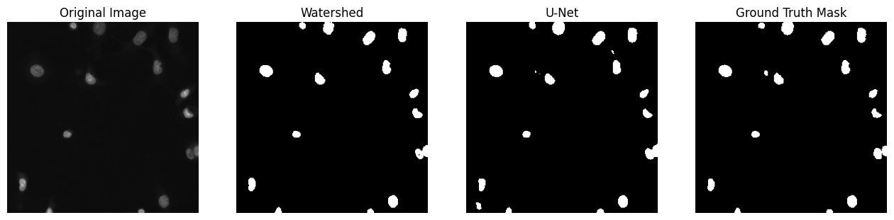

# Nuclei Segmentation: Watershed vs. U-Net

Segmenting cell nuclei in microscopy images, comparing a classical image-processing pipeline with a U-Net built from scratch. Course project for Pattern Recognition at Princess Sumaya University for Technology.

## Data

[2018 Data Science Bowl](https://www.kaggle.com/c/data-science-bowl-2018) (Kaggle): 670 training images, each with one mask per nucleus. The per-nucleus masks are merged into a single binary mask, and images and masks are resized to 256×256 and normalized.

## Approach

**1. Classical baseline: Otsu + watershed**
- Grayscale conversion and Otsu thresholding to separate nuclei from background
- Euclidean distance transform and local-maxima detection to place one marker per nucleus
- Marker-based watershed to split touching nuclei

**2. U-Net (TensorFlow/Keras)**
- Compact 3-level encoder–decoder with skip connections (~118K parameters)
- 90/10 train/validation split, Adam optimizer, binary cross-entropy, 20 epochs
- Sigmoid output thresholded at 0.5

**3. Evaluation**
- Dice coefficient and IoU, implemented in NumPy
- Side-by-side visual comparison: image, watershed, U-Net, ground truth

## Results

| Method | Mean Dice | Mean IoU |
|---|---|---|
| Otsu + watershed | 0.73 | 0.66 |
| U-Net | **0.88** | **0.81** |

The U-Net produces cleaner nucleus shapes and handles dim or touching nuclei better than the threshold-based pipeline.

*Note: the watershed scores are averaged over all 670 images and the U-Net scores over the 67-image validation split. Watershed has no training step, so its score on the full set is a fair estimate, but evaluating both on the same images would make the comparison exact.*

## Run it

The notebook was written for Kaggle, where the competition data is mounted at `/kaggle/input/data-science-bowl-2018/`. Open `nuclei_segmentation.ipynb` in a Kaggle notebook with that dataset attached and run all cells.

Libraries: NumPy, scikit-image, SciPy, scikit-learn, Matplotlib, TensorFlow/Keras.
